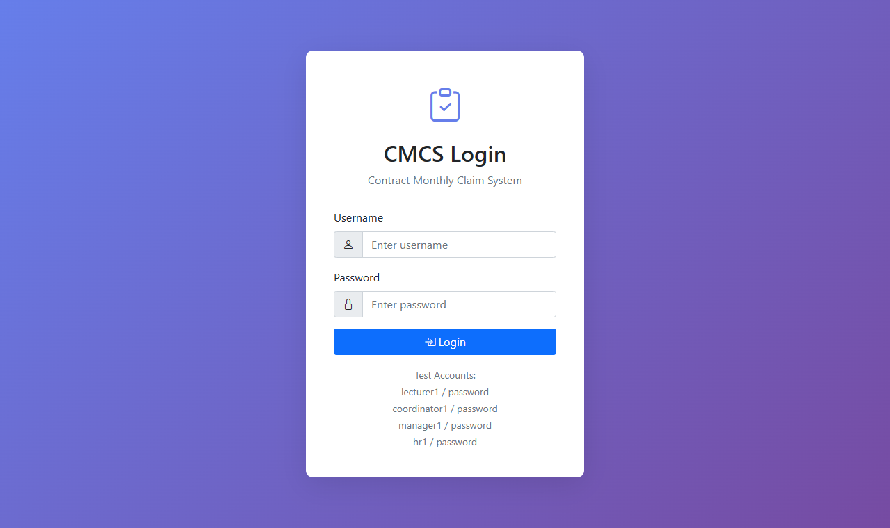
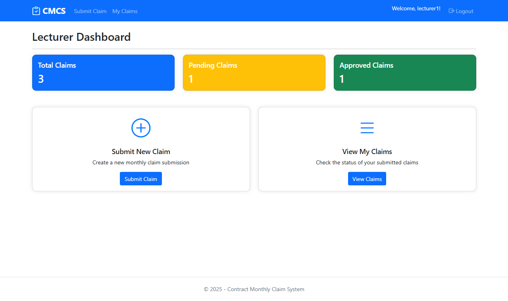
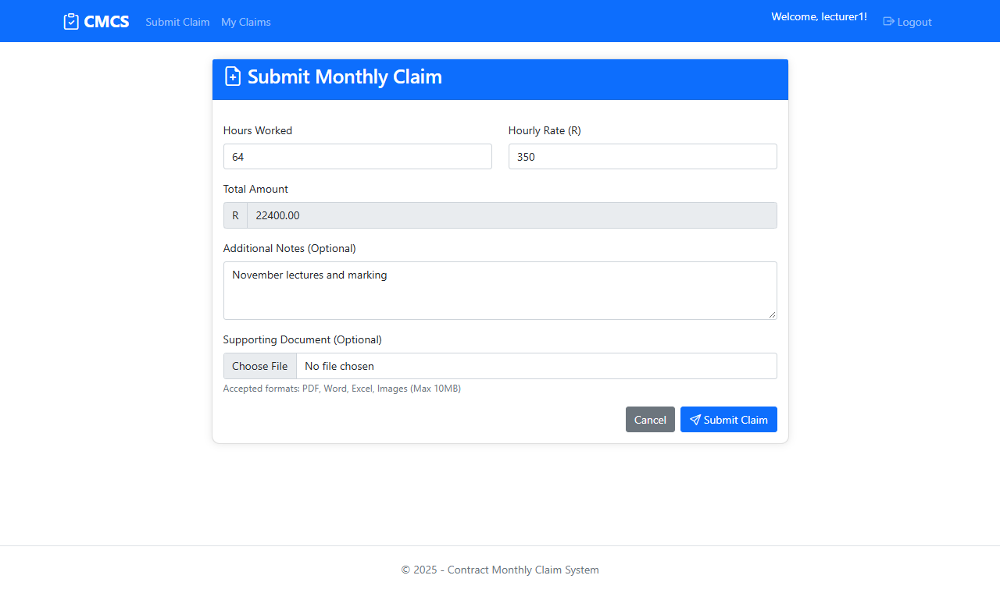
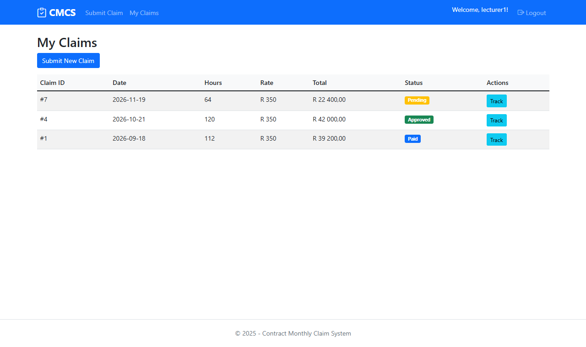
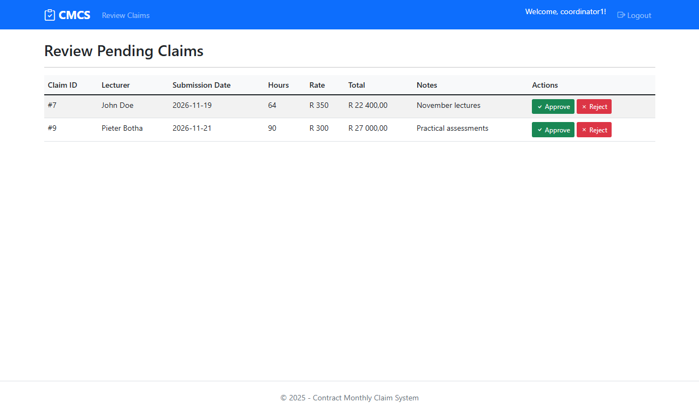
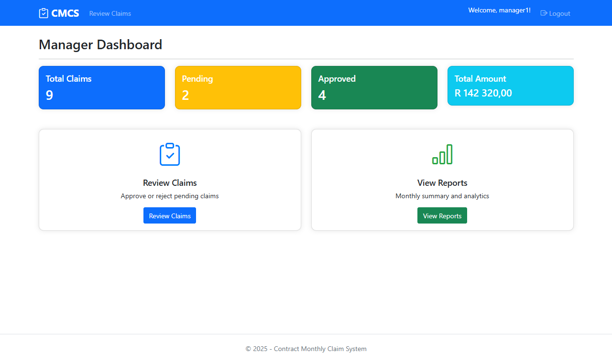
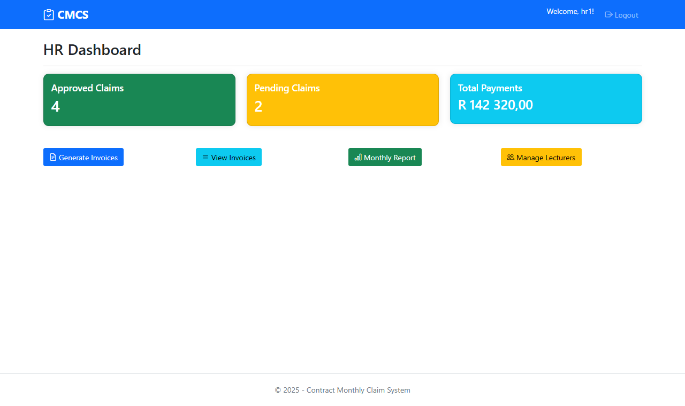
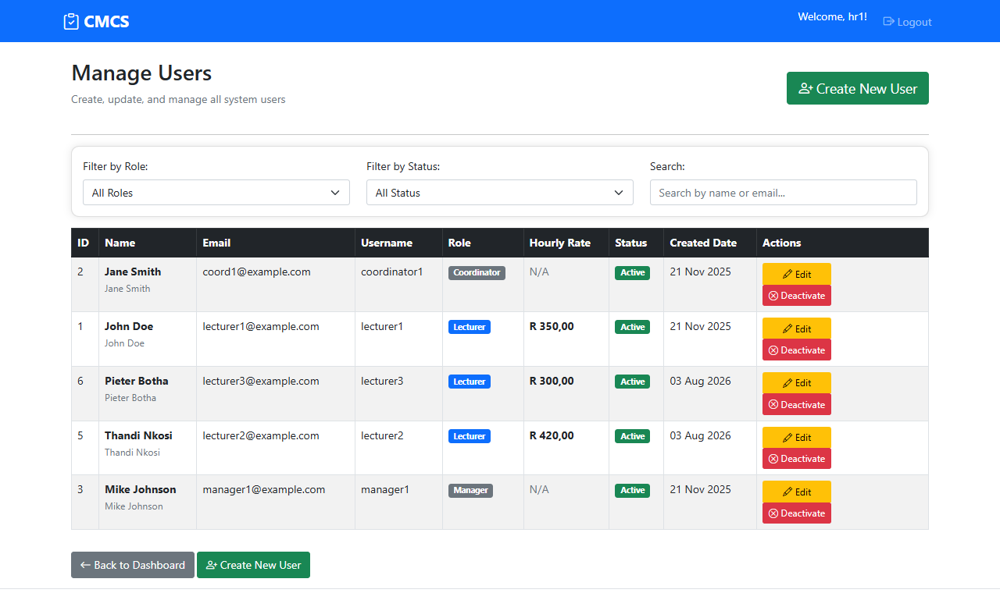
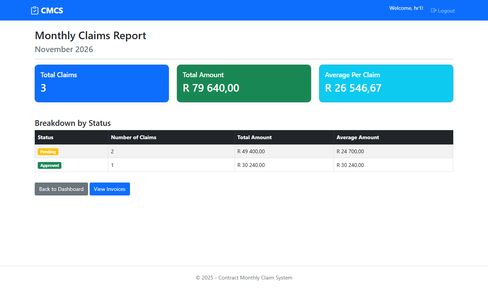

# Contract Monthly Claim System (CMCS)

An ASP.NET Core MVC web app for handling monthly pay claims from contract lecturers. Lecturers submit claims for hours worked, coordinators and academic managers review them, and HR manages user accounts, invoices and monthly reports.

I built this as my final Portfolio of Evidence for PROG6212 (Programming 2B) in the BCAD programme at The Independent Institute of Education (Varsity College).

> **Note:** This repository is a copy of my original submission repo, which lives in the college's GitHub Classroom organisation. Students can't change repository visibility there, so I moved the project to my own account to make it public. The full commit history came across with it: the original work dates from November 2025, and the later commits are fixes I made when I came back to it.

   

---

## What it does

The app has four roles. Each one gets its own dashboard and can only reach its own pages.

| Role | What they can do |
|---|---|
| **Lecturer** | Submit a monthly claim (hours × rate, worked out live as they type), attach a supporting document, and follow each claim's status |
| **Programme Coordinator** | See pending claims and approve or reject them |
| **Academic Manager** | See every claim, approve or reject them, and view a month-by-month summary report |
| **HR** | Create, edit, activate, deactivate and delete users; set lecturer hourly rates; view approved claims as invoices and mark them paid; run the monthly claims report |

There is no public sign-up page. HR creates every account and hands out the login details.

### Business rules in the code

- Hours must be above 0 and no more than 200 per claim. The hourly rate must be above 0.
- A lecturer can submit one claim per calendar month.
- Uploads are optional. They must be PDF, Word, Excel or an image, and no larger than 10 MB. Files get a GUID prefix so names can't clash.
- The total is calculated on the server (`Claim.CalculateTotal()`), and `claim-automation.js` shows it in the form as the lecturer types.
- Every controller action checks the role stored in the session. If you're not logged in, or you have the wrong role, you're sent back to the login page.

---

## Screenshots

The screenshots use sample data (three lecturers with claims over three months).

| Login | Lecturer dashboard |
|---|---|
|  |  |
| **Submitting a claim** (the total updates as you type) | **A lecturer's claim history** |
|  |  |
| **Coordinator reviewing pending claims** | **Manager dashboard** |
|  |  |
| **HR dashboard** | **HR user management** |
|  |  |
| **HR monthly report** | |
|  | |

---

## Tech stack

- **Backend:** C#, ASP.NET Core 8 MVC (controllers and Razor views)
- **Auth:** custom session-based login with per-role guards (no ASP.NET Identity)
- **Data:** JSON file storage through `DataService` (`App_Data/users.json` and `claims.json`). An Entity Framework Core / SQL Server data layer (`ApplicationDbContext`, `Database/CreateDatabase.sql`) is included as the planned move to a relational database.
- **Frontend:** Bootstrap 5, Bootstrap Icons, vanilla JavaScript
- **Tests:** xUnit project scaffold (`CMCS.Tests`)

## Project structure

```
ContractMonthlyClaimSystem/
├── Controllers/     Account, Lecturer, Claim, Coordinator, Manager, HR, Home
├── Services/        DataService (JSON persistence), ClaimService (validation and processing),
│                    ValidationService (file and value checks), plus EF Core reporting/invoice services
├── Models/          User, Claim, Document, Invoice, ApprovalHistory, view models
├── Views/           Razor views for each role
├── Data/            EF Core DbContext and seeder
├── Database/        SQL Server schema script
├── App_Data/        JSON data store (sample users and claims)
└── wwwroot/         CSS, JS (live total calculation), uploaded documents
CMCS.Tests/          xUnit test project
```

---

## Running it locally

**You need:** the [.NET 8 SDK](https://dotnet.microsoft.com/download/dotnet/8.0). You don't need a database, because the app reads and writes its JSON files in `App_Data/`.

```bash
git clone https://github.com/VCPTA/bcad2-prog6212-poe-submission-ST10089153.git
cd bcad2-prog6212-poe-submission-ST10089153
dotnet run --project ContractMonthlyClaimSystem --launch-profile http
```

Then open **http://localhost:5028**.

You can also open `ContractMonthlyClaimSystem.sln` in Visual Studio 2022 and press F5.

### Demo accounts

| Role | Username | Password |
|---|---|---|
| Lecturer | `lecturer1` | `password` |
| Coordinator | `coordinator1` | `password` |
| Manager | `manager1` | `password` |
| HR | `hr1` | `password` |

To try the whole flow: log in as `lecturer1` and submit a claim. Log in as `coordinator1` and approve it. Then log in as `hr1` to see it under invoices and the monthly report.

---

## What I'd improve next

This is a student project, and I know where it falls short of production:

- **Password hashing.** The demo accounts store passwords in plain text. The next step is hashing them with ASP.NET Core Identity's `PasswordHasher` or BCrypt.
- **Moving to the database.** The EF Core context and SQL schema are written, but the controllers still use the JSON `DataService`. Switching them to `ApplicationDbContext` would bring proper relational integrity and safe concurrent writes.
- **A true two-step approval.** At the moment a coordinator or a manager can approve a claim on their own. The plan is coordinator verifies → manager approves, with an `ApprovalHistory` audit trail.
- **Tests.** Unit tests for `ClaimService` and `ValidationService`, and integration tests for the role guards.
- **Anti-forgery tokens** on every POST action, and a shared authorisation filter instead of repeating the role checks in each action.

---

## About

Built by **Charné Janse van Rensburg** (ST10089153), BCAD student at IIE Varsity College.

This repository was submitted for academic assessment for PROG6212 and is not licensed for commercial use.
